# gobgp

[](https://github.com/shamalawy/gobgp/actions/workflows/ci.yml)
[](https://github.com/shamalawy/gobgp/releases/latest)
[](LICENSE)

A BGP-4 daemon written in Go that ships as one binary with its web UI inside.
It peers over IPv4 and IPv6, reflects routes, monitors them, and can load and
re-advertise a full internet routing table.

The protocol engine is [GoBGP v4](https://github.com/osrg/gobgp). This project
adds the parts around it: persistent configuration, a REST and live event API,
a RIB explorer that handles a million routes, a bulk route injector for MRT
dumps, and an Angular UI.

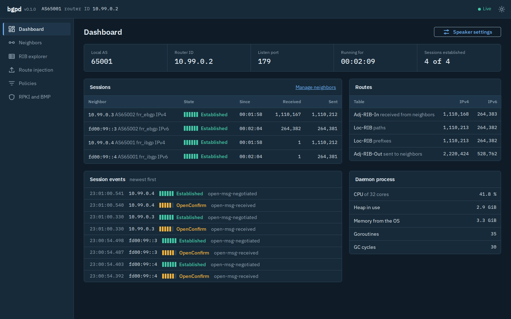

## Contents

- [What it does](#what-it-does)
- [Install](#install)
- [First start](#first-start)
- [Use cases](#use-cases): [route reflector](#route-reflector),
  [route monitoring](#route-monitoring), [full-table feed](#full-table-feed)
- [The web UI](#the-web-ui)
- [Configuration reference](#configuration-reference)
- [Bulk injection](#bulk-injection)
- [API](#api)
- [Metrics](#metrics)
- [Lab](#lab)
- [Performance](#performance)
- [Standards](#standards)
- [Limits you should know](#limits-you-should-know)
- [Development](#development)
- [Versions and releases](#versions-and-releases)

## What it does

- **Peering.** eBGP and iBGP over IPv4 and IPv6, with 4-octet AS numbers,
  ADD-PATH, graceful restart, extended messages, TCP MD5, TCP-AO, GTSM and BFD.
- **Route reflection.** Per-neighbor route reflector client flag and cluster
  ID. Confederations and route server clients too.
- **Policy.** Prefix sets, AS path sets and community sets, combined in route
  maps that accept, reject or rewrite routes on import and export.
- **Route monitoring.** A live session event log, a searchable RIB with
  longest-prefix lookups, RPKI origin validation, BMP export and Prometheus
  metrics.
- **Route injection.** Originate single routes by hand, or load a full table
  from an MRT dump, CSV or JSON, with rate limiting and attribute rewriting.
- **One file to deploy.** The UI is embedded in the binary. Configuration lives
  in one YAML file and survives restarts.

## Install

### Linux binary

Static binaries for `amd64` and `arm64` are attached to every
[release](https://github.com/shamalawy/gobgp/releases). They have no
dependencies.

```sh
VERSION=0.1.0
curl -LO https://github.com/shamalawy/gobgp/releases/download/v$VERSION/bgpd_${VERSION}_linux_amd64.tar.gz
curl -LO https://github.com/shamalawy/gobgp/releases/download/v$VERSION/checksums.txt
sha256sum --check --ignore-missing checksums.txt
tar xzf bgpd_${VERSION}_linux_amd64.tar.gz
sudo install bgpd /usr/local/bin/bgpd
bgpd -version
```

### Docker

```sh
docker run -d --name gobgp_bgpd --network host \
  -v gobgp_data:/data \
  ghcr.io/shamalawy/gobgp:0.1.0 \
  -http 127.0.0.1:8080 -asn 65001 -router-id 192.0.2.1
```

Host networking lets the daemon use the host's addresses for BGP, which TCP MD5
and TTL security need. On a bridge network, publish port 179 instead
(`-p 179:179 -p 127.0.0.1:8080:8080`) and pass `-http 0.0.0.0:8080`.

Images are built for `linux/amd64` and `linux/arm64`. The configuration is kept
in the `/data` volume.

### From source

Needs Go 1.26 and Node.js 22.

```sh
git clone https://github.com/shamalawy/gobgp && cd gobgp
make build          # builds the UI, then bin/bgpd
```

## First start

```sh
sudo bgpd -asn 65001 -router-id 192.0.2.1
```

Open <http://127.0.0.1:8080>. The first start writes `data/bgpd.yaml`. Every
change made in the UI or through the API is saved there, so the daemon comes
back with the same neighbors, policies and static routes.

| Flag | Default | Meaning |
| --- | --- | --- |
| `-data-dir` | `data` | Holds `bgpd.yaml` and uploaded dumps |
| `-http` | `127.0.0.1:8080` | UI, REST API and `/metrics` |
| `-grpc` | off | GoBGP's native gRPC API, for the `gobgp` CLI, e.g. `127.0.0.1:50051` |
| `-seed` | | A configuration file copied into the data directory on the first start |
| `-asn` | `64512` | Local AS for a first start without `-seed` |
| `-router-id` | first IPv4 address | Router ID for a first start without `-seed` |
| `-log-level` | `info` | `debug`, `info`, `warn` or `error` |
| `-version` | | Print the version and exit |

**The UI and API have no authentication.** Keep `-http` on loopback or a
management network, or put a reverse proxy with authentication in front.

Port 179 needs root or `CAP_NET_BIND_SERVICE`. To run unprivileged, set another
`listenPort` in the configuration.

### As a systemd service

```ini
# /etc/systemd/system/bgpd.service
[Unit]
Description=bgpd BGP daemon
After=network-online.target
Wants=network-online.target

[Service]
ExecStart=/usr/local/bin/bgpd -data-dir /var/lib/bgpd
Restart=on-failure
DynamicUser=yes
StateDirectory=bgpd
AmbientCapabilities=CAP_NET_BIND_SERVICE CAP_NET_ADMIN
LimitNOFILE=65536

[Install]
WantedBy=multi-user.target
```

```sh
sudo systemctl daemon-reload && sudo systemctl enable --now bgpd
```

## Use cases

### Route reflector

A route reflector lets iBGP routers share routes without a full mesh
(RFC 4456). Mark each iBGP neighbor as a client. Routes learned from one client
are reflected to the others, with the originator ID and cluster list set so
loops are detected.

```yaml
global:
  asn: 65001
  routerId: 10.0.0.1
  listenPort: 179
neighbors:
  - address: 10.0.0.11
    remoteAsn: 65001              # same AS: iBGP
    description: edge-1
    families: [ipv4-unicast, ipv6-unicast]
    routeReflectorClient: true
    clusterId: 10.0.0.1           # optional; defaults to the router ID
    addPathSendMax: 4             # optional: reflect up to 4 paths per prefix (RFC 7911)
  - address: 10.0.0.12
    remoteAsn: 65001
    description: edge-2
    families: [ipv4-unicast, ipv6-unicast]
    routeReflectorClient: true
  - address: 10.0.0.2
    remoteAsn: 65001
    description: second reflector (non-client)
```

In the UI: **Neighbors → Add neighbor → Route reflection and ADD-PATH → Route
reflector client**.

Notes:

- The daemon is a control-plane reflector. It does not install routes into the
  kernel, so it must not be in the forwarding path.
- For redundancy, run two reflectors with the same `clusterId`, or different
  ones if clients peer with both and you accept the extra paths.
- The [lab](#lab) runs this setup: `frr_ibgp` is a client and receives the
  routes learned from the eBGP router.

### Route monitoring

Run the daemon as a passive collector: it receives routes from your routers and
never advertises any. You then watch them in the UI, export them over BMP, and
alert on them with Prometheus.

```yaml
global:
  asn: 65001
  routerId: 10.0.0.250
  listenPort: 179
  export:
    default: reject               # never advertise anything to anyone
neighbors:
  - address: 10.0.0.11
    remoteAsn: 65001
    description: edge-1 (monitored)
    families: [ipv4-unicast, ipv6-unicast]
    passive: true                 # wait for the router to connect
    addPathReceive: true          # see every path, not only the router's best
rpki:
  - address: 192.0.2.53           # an RTR cache, by IP address
    port: 3323
bmp:
  - address: 192.0.2.60
    port: 11019
    policy: all
```

What you get:

| Need | Where |
| --- | --- |
| Is a session up, and why did it drop? | Dashboard and Neighbors, live. `log` events on the event stream |
| Which route does the network use for an address? | RIB explorer, enter the address: longest-prefix match |
| What did a router send before policy? | RIB explorer, table **Adj-RIB-In** |
| Who originates a prefix, or who routes through AS X? | RIB explorer, AS path regular expression |
| Is an origin RPKI valid? | RIB explorer, RPKI column |
| Feed a collector such as OpenBMP or pmacct | BMP station, RFC 7854, including Loc-RIB (RFC 9069) |
| Alert on session state and prefix counts | [Prometheus metrics](#metrics) |
| React to changes from a script | [Event stream](#events) |

### Full-table feed

Load a real internet table and advertise it to a router under test: to check
its memory, convergence time or policy. See [Bulk injection](#bulk-injection).

```sh
curl -X POST http://127.0.0.1:8080/api/v1/inject \
  -d '{"source":"https://data.ris.ripe.net/rrc26/latest-bview.gz","nextHopSelf":true}'
```

## The web UI

The UI works in a dark and a light theme and on a phone.

| Dark | Light | Phone |
| --- | --- | --- |
|  | 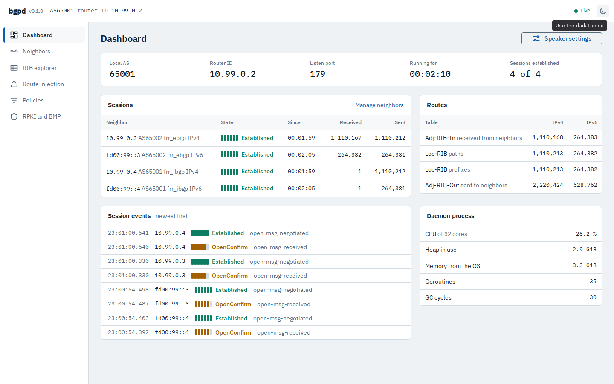 | 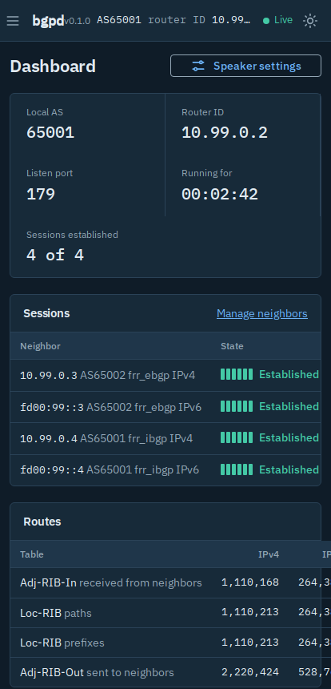 |

### Dashboard

Speaker identity, every session with its state, the route counts of each table
per address family, the daemon's CPU and memory, and a live log of session
state changes. **Speaker settings** edits the AS number, router ID, listener
and confederation.

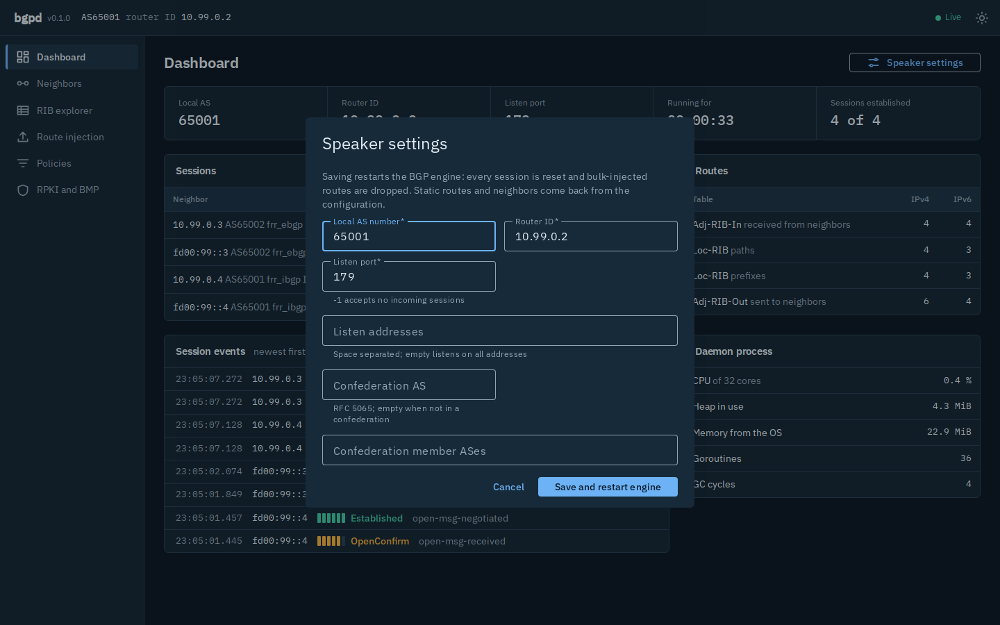

### Neighbors

All peers with their state, time up or down, prefixes received and sent, and
the capabilities both sides agreed on. The six bars show where the session is
in the BGP state machine, from Idle to Established.

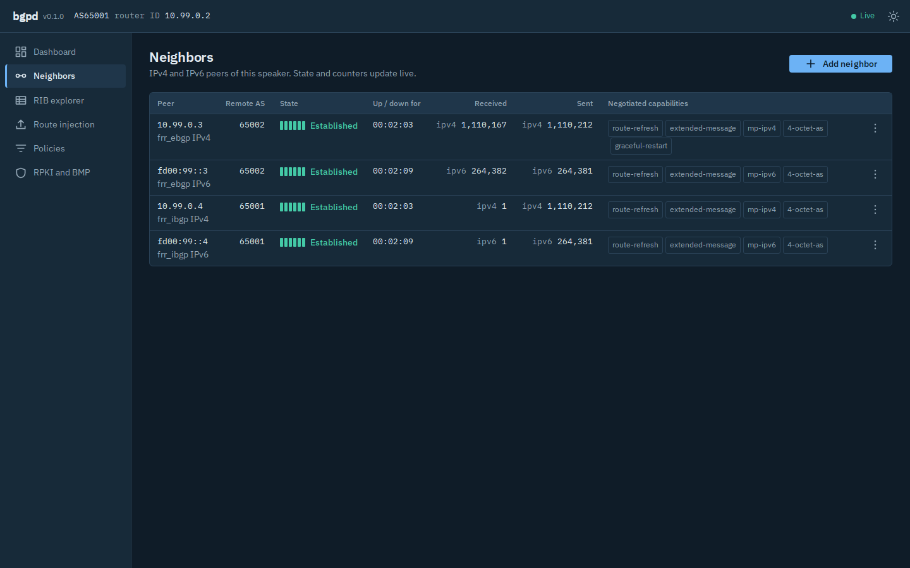

Each row has the operational actions:

- **Shut down** and **Enable**: administrative shutdown (RFC 4486), with an
  optional message sent to the peer (RFC 8203). The state is saved.
- **Soft reset inbound**: asks the peer to resend its routes (route refresh).
- **Soft reset outbound**: resends this speaker's routes.
- **Hard reset**: tears the session down and brings it back.
- **Edit** and **Delete**.

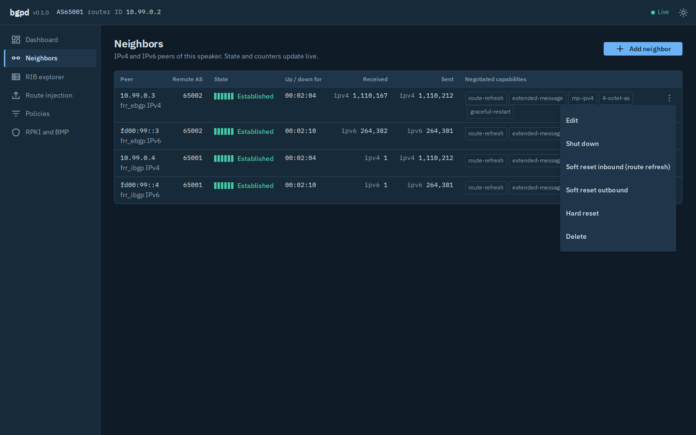

The form validates addresses and AS numbers as you type. It covers timers, TCP
MD5 and TCP-AO, multihop and TTL security, BFD, route reflection, ADD-PATH,
graceful restart, import and export policy, prefix limits and private AS
handling.

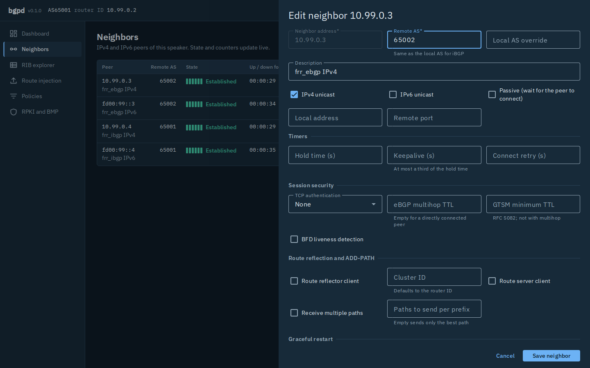

### RIB explorer

Browses the Loc-RIB, or the Adj-RIB-In and Adj-RIB-Out of a neighbor. The table
is paged from the daemon as you scroll, so the browser holds a few thousand
rows however large the table is.

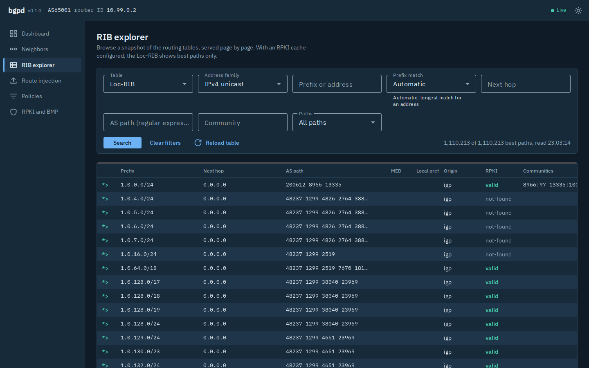

Filters:

| Filter | Example | Result |
| --- | --- | --- |
| Address | `8.8.8.8` | The longest matching route |
| Prefix | `8.8.0.0/16` | That prefix and its more specifics |
| Prefix match | Exact, Longest match, More specifics, Covering routes | |
| Next hop | `192.0.2.1` | Routes with that next hop |
| AS path | `^65001 ` or ` 15169$` | A regular expression over the AS path |
| Community | `65000:100` | Standard, extended or large community |
| Paths | Best only, non-best only | |

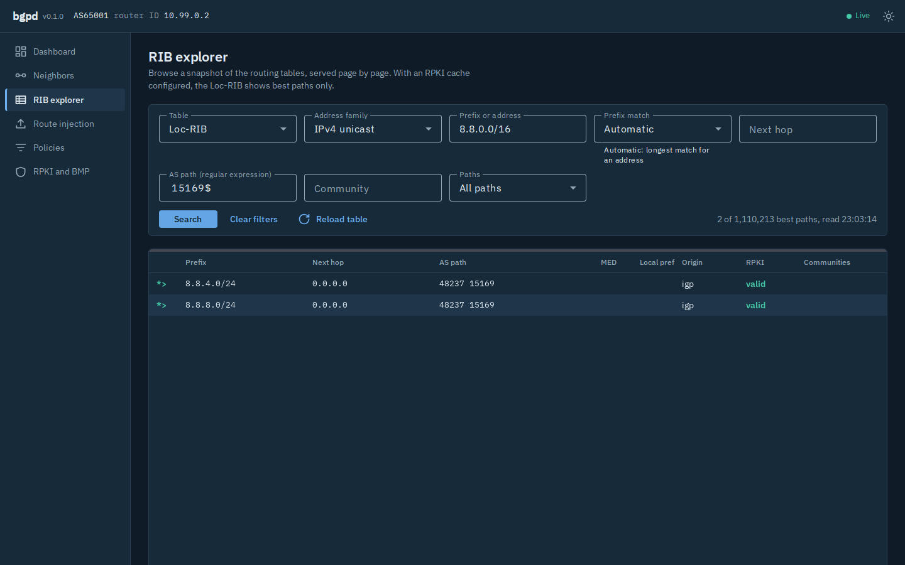

The daemon reads the table once into a snapshot and searches that. **Search**
reuses the snapshot; **Reload table** reads the table again.

### Route injection

**Originate a route** announces one prefix with the attributes you choose: next
hop, AS path, origin, MED, local preference and standard, extended and large
communities. These static routes are saved and shown below the form.

**Inject a full table** loads a dump from an upload, a URL or a path on the
server. A progress bar and a routes-per-second chart follow the run.

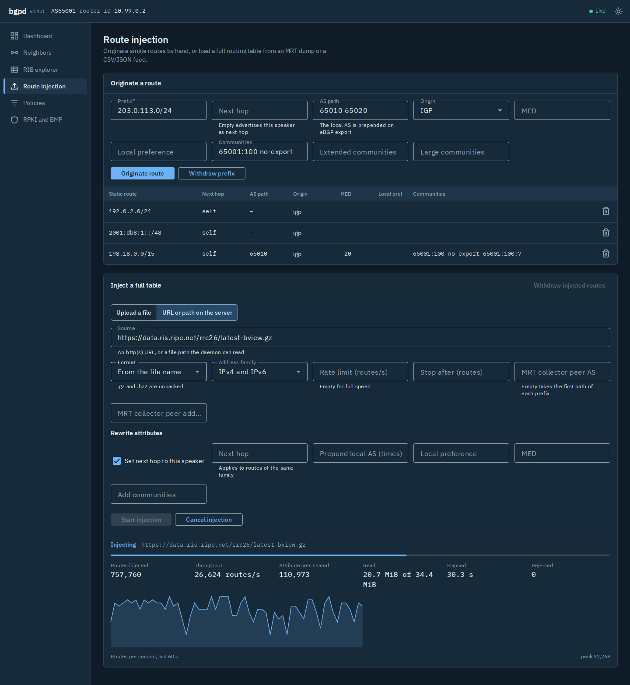

### Policies

Route maps are ordered lists of statements. Each statement matches on sets and
RPKI state, changes attributes, and accepts, rejects or continues.

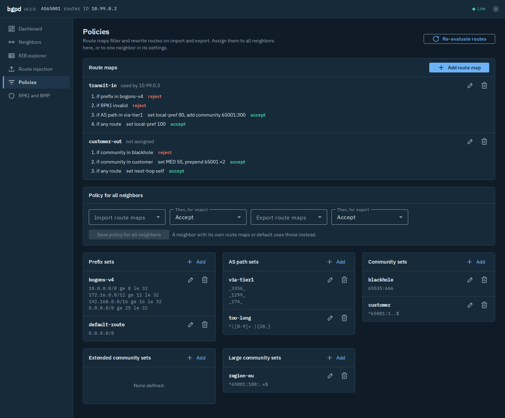

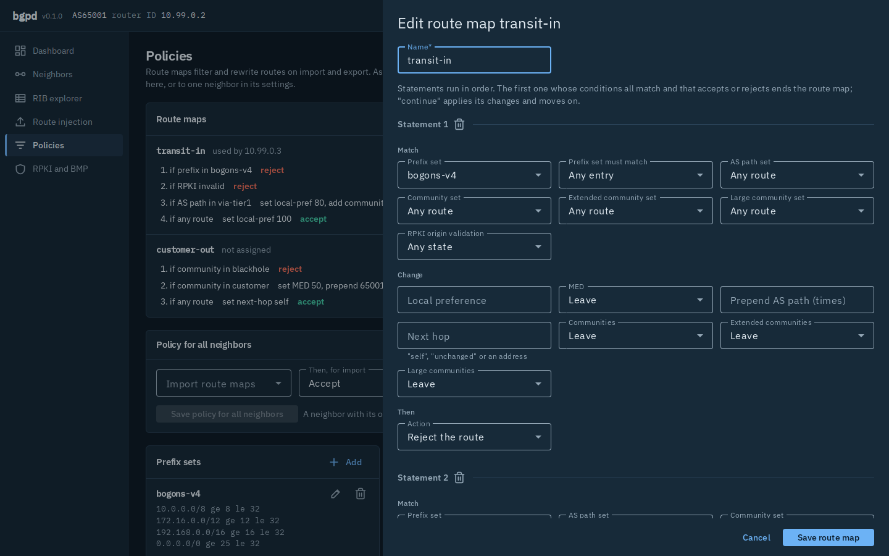

Assign route maps to all neighbors on this page, or to one neighbor in its
form. A policy change applies to new updates; **Re-evaluate routes** soft
resets the established neighbors so existing routes pass through it too.

### RPKI and BMP

RPKI cache servers (RTR, RFC 8210) with their session state and ROA counts, and
BMP monitoring stations.

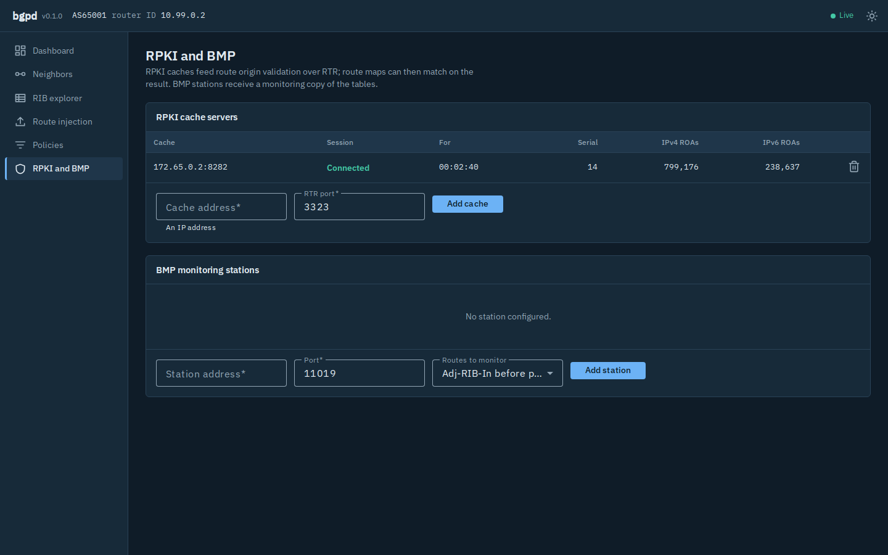

## Configuration reference

`bgpd.yaml` in the data directory. The daemon rewrites it on every change, so
edit it only while the daemon is stopped. Unknown keys are rejected at startup.

```yaml
global:
  asn: 65001                      # required
  routerId: 192.0.2.1             # required, IPv4
  listenPort: 179                 # -1 accepts no incoming sessions
  listenAddresses: [192.0.2.1]    # optional; default all addresses
  confederation:                  # optional, RFC 5065
    id: 65000
    members: [65001, 65002]
  import: { policies: [transit-in], default: accept }   # for all neighbors
  export: { policies: [], default: accept }

neighbors:
  - address: 192.0.2.2            # required
    remoteAsn: 65002              # required; equal to global.asn means iBGP
    localAsn: 65010               # optional override
    description: upstream
    adminDown: false              # true keeps the session shut down
    families: [ipv4-unicast, ipv6-unicast]   # default: the family of address
    passive: false
    localAddress: 192.0.2.1
    remotePort: 179
    holdTime: 90                  # seconds; keepalive at most a third of it
    keepalive: 30
    connectRetry: 120
    password: secret              # TCP MD5, RFC 2385
    tcpAo:                        # TCP-AO, RFC 5925; not together with password
      sendId: 1
      receiveId: 1
      algorithm: hmac-sha256-128  # hmac-sha1-96, aes-128-cmac-96, hmac-sha256-96
      key: secret
    ebgpMultihop: 2               # TTL; omit for a directly connected peer
    ttlSecurityMin: 255           # GTSM, RFC 5082; not together with ebgpMultihop
    routeReflectorClient: true    # RFC 4456
    clusterId: 192.0.2.1
    routeServerClient: false
    addPathReceive: true          # RFC 7911
    addPathSendMax: 4
    gracefulRestart:              # RFC 4724
      restartTime: 120
      helperOnly: false
      notification: true          # RFC 8538
      longLived: true             # RFC 9494
      llgrTime: 3600
    bfd: { minTx: 300, minRx: 300, multiplier: 3, multihop: false }   # milliseconds
    removePrivateAs: all          # all or replace
    allowOwnAs: 1
    maxPrefixes: 1500000          # per address family
    import: { policies: [transit-in], default: reject }
    export: { policies: [customer-out] }

policy:
  prefixSets:
    - name: bogons
      prefixes:
        - { prefix: 10.0.0.0/8, le: 32 }     # the prefix and anything longer
        - { prefix: 192.0.2.0/24 }           # exact
  asPathSets:
    - { name: via-tier1, list: ["_3356_", "_1299_"] }   # regular expressions
  communitySets:
    - { name: blackhole, list: ["65535:666"] }
  extCommunitySets:
    - { name: vpn-a, list: ["rt:65001:100"] }
  largeCommunitySets:
    - { name: region-eu, list: ["^65001:100:.*$"] }
  routeMaps:
    - name: transit-in
      statements:
        - match: { prefixSet: { name: bogons } }
          action: reject
        - match: { rpki: invalid }           # valid, invalid, not-found
          action: reject
        - match: { asPathSet: { name: via-tier1, match: any } }   # any, all, invert
          set:
            localPref: 80
            med: { op: set, value: 50 }      # set, add, sub
            asPrepend: { asn: 65001, repeat: 2 }   # asn 0 repeats the leftmost AS
            nextHop: self                    # self, unchanged or an address
            communities: { op: add, values: ["65001:300"] }   # add, remove, replace
          action: accept                     # accept, reject, or omit to continue

routes:                           # static routes, originated at startup
  - prefix: 203.0.113.0/24
    nextHop: 192.0.2.1            # omit to advertise this speaker
    asPath: "65010 65020"
    origin: igp                   # igp, egp, incomplete
    med: 10
    localPref: 200
    communities: ["65001:100", no-export]
    extCommunities: ["rt:65001:100"]
    largeCommunities: ["65001:1:2"]

rpki:
  - { address: 192.0.2.53, port: 3323 }      # an IP address, not a host name

bmp:
  - { address: 192.0.2.60, port: 11019, policy: pre }   # pre, post, both, local, all
```

How policy is chosen: a neighbor with its own route maps or default uses those.
Otherwise the global `import` and `export` apply.

## Bulk injection

| Source | Notes |
| --- | --- |
| MRT `TABLE_DUMP_V2` | RIPE RIS `bview` and RouteViews `rib` files (RFC 6396, RFC 8050) |
| CSV | `prefix,next_hop,as_path,origin,med,local_pref,communities`; only the prefix is required |
| JSON | An array of route objects, or one object per line |

Files may be plain, `.gz` or `.bz2`. They come from an upload, an `http(s)` URL
or a path the daemon can read.

An MRT snapshot holds one path per collector peer for every prefix. By default
the first path of each prefix is taken, which gives the most complete table.
`peerAs` or `peerIp` picks one collector peer's view instead.

Options:

| Option | Meaning |
| --- | --- |
| `rate` | Routes per second; 0 is full speed |
| `limit` | Stop after this many routes |
| `family` | `ipv4` or `ipv6` only |
| `nextHopSelf` | Advertise with this speaker as next hop |
| `nextHop` | Rewrite the next hop of routes of that address family |
| `prepend` | Prepend the local AS this many times |
| `localPref`, `med` | Set the attribute |
| `communities` | Standard communities to add |

Injected routes are not saved to the configuration. **Withdraw injected
routes** removes them and keeps the static ones.

Identical attribute sets are parsed once and shared by all routes that carry
them: a full table has about 1.4 million routes and about 220,000 distinct
sets.

## API

JSON over HTTP under `/api/v1`. Errors come back as `{"error": "..."}` with
status 400.

| Method and path | Purpose |
| --- | --- |
| `GET /status` | Identity, version, route counts, neighbors with live state, process metrics |
| `GET /config` | The stored configuration, secrets masked |
| `PUT /global` | Speaker settings. Changing identity or listeners restarts the BGP engine |
| `POST /neighbors` | Add a neighbor |
| `PUT /neighbors/{addr}` | Change a neighbor |
| `DELETE /neighbors/{addr}` | Remove a neighbor |
| `POST /neighbors/{addr}/{action}` | `enable`, `disable`, `soft-reset`, `hard-reset`. Body: `{"direction":"in\|out\|both","message":"..."}` |
| `PUT /policy` | Replace the policy document (sets and route maps) |
| `GET /rib` | A page of a table; see below |
| `POST /routes` | Originate a static route |
| `DELETE /routes?prefix=` | Withdraw a locally originated prefix |
| `DELETE /routes/injected` | Withdraw all bulk-injected routes |
| `GET /inject` | Status of the current or last injection |
| `POST /inject` | Start an injection from a URL or server path |
| `POST /inject/upload` | Multipart: `options` (JSON), then `file` |
| `DELETE /inject` | Cancel the running injection |
| `GET /rpki`, `POST /rpki`, `DELETE /rpki?address=&port=` | RPKI caches |
| `POST /bmp`, `DELETE /bmp?address=&port=` | BMP stations |
| `GET /events` | Server-sent events |

`GET /rib` parameters: `table` (`global`, `adj-in`, `adj-out`), `neighbor`,
`family` (`ipv4`, `ipv6`), `prefix`, `match` (`exact`, `longest`, `longer`,
`shorter`), `nextHop`, `asPath`, `community`, `best` (`true`, `false`),
`offset`, `limit` (up to 1000), `refresh` (`true` reads the table again).

```sh
API=http://127.0.0.1:8080/api/v1

# Add an eBGP neighbor
curl -X POST $API/neighbors -d '{"address":"192.0.2.2","remoteAsn":65002,"description":"upstream"}'

# Shut it down with a message, then bring it back
curl -X POST $API/neighbors/192.0.2.2/disable -d '{"message":"maintenance"}'
curl -X POST $API/neighbors/192.0.2.2/enable

# Originate and withdraw a route
curl -X POST $API/routes -d '{"prefix":"203.0.113.0/24","communities":["65001:100"]}'
curl -X DELETE "$API/routes?prefix=203.0.113.0/24"

# Which route covers 8.8.8.8?
curl "$API/rib?family=ipv4&prefix=8.8.8.8"

# Routes originated by AS 15169, 50 at a time
curl "$API/rib?family=ipv4&asPath=%2015169%24&limit=50"

# Upload and inject a dump at 20,000 routes per second
curl -X POST $API/inject/upload -F 'options={"rate":20000,"nextHopSelf":true}' -F file=@rib.mrt.gz
```

### Events

`GET /api/v1/events` is a server-sent event stream. A new client first gets the
current status, the injection status and the last 200 session events.

| Event | Sent | Data |
| --- | --- | --- |
| `status` | Every 2 s, and right after a session changes state | The `/status` document |
| `log` | On every session state change | `{"time","peer","asn","state","reason"}` |
| `inject` | Twice a second during an injection | The `/inject` document |

```sh
curl -N http://127.0.0.1:8080/api/v1/events
```

### gRPC

Start with `-grpc 127.0.0.1:50051` to serve GoBGP's native gRPC API. The
`gobgp` command line tool then works against the daemon:

```sh
gobgp neighbor
gobgp global rib -a ipv6
```

Changes made over gRPC are not written to `bgpd.yaml`.

## Metrics

`GET /metrics` serves Prometheus metrics: the Go runtime, the process, and per
peer:

| Metric | Meaning |
| --- | --- |
| `bgp_peer_session_state` | 1 Idle … 6 Established |
| `bgp_peer_admin_state` | 1 up, 2 shut down |
| `bgp_peer_uptime` | Unix time the session last came up |
| `bgp_peer_flop_count` | Session flaps |
| `bgp_routes_received`, `bgp_routes_accepted`, `bgp_routes_advertised` | Per address family |
| `bgp_received_update_total`, `bgp_sent_update_total` | And the same for `open`, `keepalive`, `notification`, `refresh`, `message` |
| `bgp_peer_out_queue_count` | Messages waiting to be sent |

Example alerts:

```yaml
- alert: BgpSessionDown
  expr: bgp_peer_session_state != 6 and bgp_peer_admin_state == 1
  for: 2m
- alert: BgpPrefixDrop
  expr: bgp_routes_received < 0.8 * avg_over_time(bgp_routes_received[1d])
  for: 10m
```

## Lab

A Docker Compose lab peers the daemon with two FRRouting routers over IPv4 and
IPv6: `gobgp_frr_ebgp` in AS 65002 and `gobgp_frr_ibgp` in AS 65001 as a route
reflector client.

```sh
make lab            # UI on http://127.0.0.1:8080
make lab-down
```

Set `BGPD_HTTP_PORT` if host port 8080 is taken. To check the routers:

```sh
docker exec gobgp_frr_ebgp vtysh -c 'show bgp summary'
docker exec gobgp_frr_ibgp vtysh -c 'show bgp ipv4 unicast'
```

## Performance

Measured on a 32-core Xeon E5-2673 v4.

| Measurement | Result |
| --- | --- |
| Inject 1.2M routes, no neighbors (`make bench`) | about 14 s, 85,000 routes/s |
| Inject a RIPE RIS table (1,374,588 routes) while advertising to 4 FRR sessions | about 52 s |
| Memory per route in the Loc-RIB | about 630 bytes |
| Read a 1.1M-route table into a RIB explorer snapshot | about 8 s |
| A page or a lookup on the snapshot | about 0.1 ms |

Plan memory for the tables you hold: a full table from one neighbor needs about
1 GiB, and each additional full Adj-RIB-In or Adj-RIB-Out adds to that. Most of
the per-route cost is in the GoBGP engine.

## Standards

Implemented by the GoBGP engine and configurable here:

| Area | RFCs |
| --- | --- |
| Core | 4271 BGP-4, 4760 multiprotocol, 5492 capabilities, 6793 4-octet AS, 8950 IPv4 routes with an IPv6 next hop, 8654 extended messages |
| Scaling | 4456 route reflection, 5065 confederations, 7911 ADD-PATH, 2918 route refresh |
| Resilience | 4724 graceful restart, 8538 notification support, 9494 long-lived graceful restart, 4486 and 8203 administrative shutdown, BFD |
| Security | 2385 TCP MD5, 5925 TCP-AO, 5082 GTSM, 6811 and 8210 RPKI origin validation |
| Communities | 1997 standard, 4360 extended, 8092 large |
| Monitoring | 7854 BMP, 9069 BMP Loc-RIB, 6396 and 8050 MRT (reading) |

Tested against FRRouting 10.2: eBGP and iBGP sessions over IPv4 and IPv6, a
full-table exchange, route reflection, administrative shutdown and resets, and
RPKI validation against a public RTR cache. TCP MD5, TCP-AO, BFD, GTSM and BMP
are wired to the engine but have not been tested against a live peer in this
project.

## Limits you should know

- **No authentication** on the UI and API.
- **No forwarding.** Routes are not installed into the kernel.
- **RFC 9234 (BGP roles) and RFC 7313 (enhanced route refresh)** are not
  available: GoBGP v4.11 does not implement them.
- **RPKI caches must be given by IP address.**
- **With an RPKI cache configured, the Loc-RIB view shows best paths only.**
  Listing all paths makes the engine validate the whole table while holding its
  lock. For the same reason, opening the Adj-RIB-In or Adj-RIB-Out of a
  full-table neighbor then stalls the daemon for minutes.
- **MRT BGP4MP update files are not read**, only RIB snapshots.
- **Bulk-injected routes are not saved** across restarts.
- **Locally originated routes ignore `no-export`**: the engine applies the
  well-known communities to received routes only.
- **Linux only** for TCP MD5, TCP-AO and TTL security.

## Development

```sh
make test           # unit tests and loopback peering tests
make bench          # injects 1.2M routes into a fresh engine
cd web && npm start # UI dev server on :4200, proxying the API to :8080
```

| Path | Content |
| --- | --- |
| `cmd/bgpd` | Flags and wiring |
| `internal/config` | Configuration schema, validation and the YAML store |
| `internal/bgp` | GoBGP wrapper: engine, policy conversion, RIB snapshots, injector |
| `internal/mrt` | Streaming MRT reader |
| `internal/api` | REST handlers, event stream, static UI |
| `web` | Angular application |
| `deploy/lab` | Lab configuration |

Pull requests run the CI workflow: UI build, `gofmt`, `go vet`, tests and a
Docker build.

## Versions and releases

Versions follow [Semantic Versioning](https://semver.org). While the version is
0.x, the configuration format and the API may change between minor versions.
Changes are listed in [CHANGELOG.md](CHANGELOG.md).

Pushing a tag `vX.Y.Z` runs the release workflow, which tests the code, attaches
the Linux binaries and their checksums to a GitHub release, and pushes the
Docker image `ghcr.io/shamalawy/gobgp` with the tags `X.Y.Z` and `latest`.

```sh
git tag -a v0.2.0 -m "v0.2.0" && git push origin v0.2.0
```

## License

[MIT](LICENSE)
